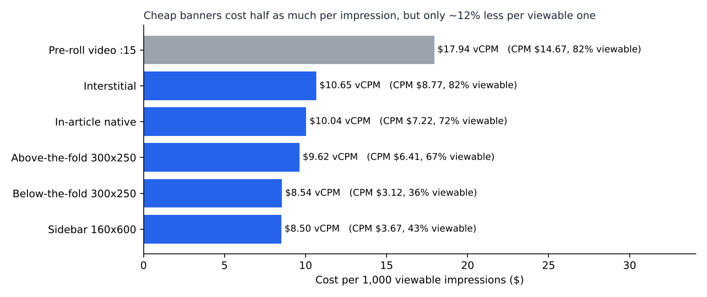
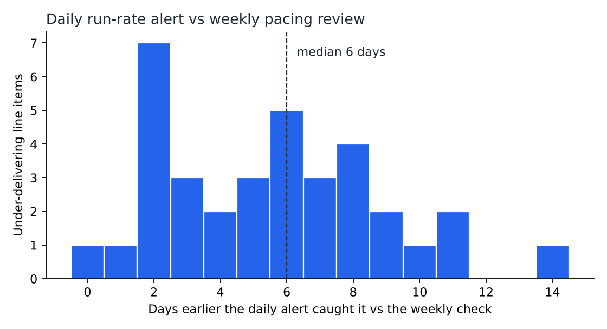
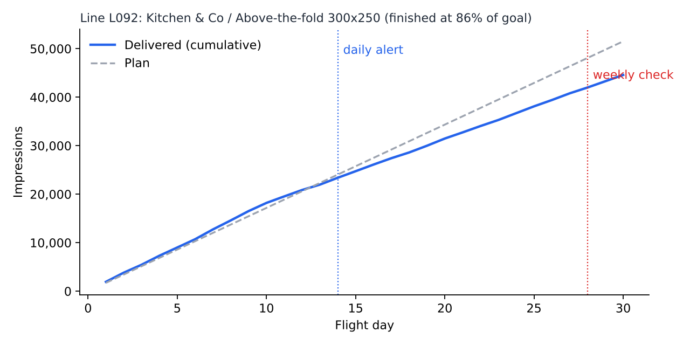

# Ad Campaign Performance Analytics

SQL and Python analysis of programmatic display and video delivery: **30.1M impressions** across 12 campaigns, 128 line items, 5 publishers, and 6 placements. It answers three questions an account or ad-ops analyst gets asked every week:

1. Which placements actually give us the best value once you count only what people see?
2. If we move budget, how much more do we get for the same money?
3. Can we spot under-delivering line items earlier than the weekly pacing review?

> **All data is simulated** (`src/generate_data.py`, fixed seed). Publishers and advertisers are fictional. I built this to practice the analysis, not to report on real campaigns.

**Tools:** SQL (SQLite, window functions), Python (pandas, matplotlib), Tableau

---

## Key findings

### 1. CPM alone overstates how cheap cheap inventory is



| Placement | CPM | CTR | Viewability | vCPM |
|---|---|---|---|---|
| Sidebar 160x600 | $3.67 | 0.05% | 43% | $8.50 |
| Below-the-fold 300x250 | $3.12 | 0.06% | 37% | $8.54 |
| Above-the-fold 300x250 | $6.41 | 0.12% | 67% | $9.62 |
| In-article native | $7.22 | 0.19% | 72% | $10.04 |
| Interstitial | $8.77 | 0.44% | 82% | $10.65 |
| Pre-roll video :15 | $14.67 | 0.32% | 82% | $17.94 |

Below-the-fold banners cost half as much per impression as above-the-fold. But only about 37% of them are seen, so per *viewable* impression (vCPM) they're only about 12% cheaper.

### 2. A budget shift is worth 3.5% more viewable impressions, not the 14% CPM suggests

Display buys were split into thirds by vCPM. Half the spend in the worst third ($10.68 vCPM) was moved to the best third ($8.47 vCPM), and each receiving buy was capped at +50% growth to reflect inventory limits.

| | Now | After shift | Change |
|---|---|---|---|
| Display spend | $148,492 | $148,492 | no change |
| Viewable impressions | 15.76M | 16.32M | **+3.5%** |
| Total impressions | 29.58M | 33.76M | +14.1% |

Same budget, 3.5% more impressions people actually see. Raw impressions jump 14%, but most of that is cheap inventory nobody sees. A plan judged on CPM would overstate the gain four times over. *This is a what-if on historical rates, not a tested result.*

### 3. A daily run-rate alert catches under-delivery a median of 6 days earlier



35 of 128 line items finished below 90% of their impression goal. I backtested two ways of catching them:

| | Weekly pacing review | Daily run-rate alert |
|---|---|---|
| Rule | Pace < 0.90 at days 7, 14, 21, 28 | 3-day run rate projects < 90% of goal, two days in a row |
| Median day caught | Day 21 | Day 14 |
| Under-deliverers caught | 34 of 35 | 35 of 35 |
| False alarms | 0 | 2 |

The daily alert caught problems **a median of 6 days earlier** (mean 5.5), with 2 false alarms out of 37 flags. That's a week more to ask the publisher for make-goods or move budget while the flight is still live.



## SQL highlights (`sql/analysis.sql`)

- **vCPM by placement and publisher.** Cost per viewable impression, the fair comparison across placements.
- **Daily pacing with window functions:**
  ```sql
  SUM(d.impressions) OVER (PARTITION BY d.line_id ORDER BY d.flight_day)        AS cum_delivered,
  AVG(d.impressions) OVER (PARTITION BY d.line_id ORDER BY d.flight_day
                           ROWS BETWEEN 2 PRECEDING AND CURRENT ROW)          AS run_rate_3d
  ```
  Projected final = delivered to date + 3-day run rate × days left.
- **Line outcomes.** Each line's delivered vs goal, flagged under-delivered below 90%.
- **Publisher delivery.** Goal vs delivered by publisher, and how many lines finished under 90%.

## Repo

```
ad-campaign-analytics/
├── src/
│   ├── generate_data.py     # simulates delivery, builds the SQLite DB
│   └── analysis.py          # runs the SQL, the budget shift and the alert backtest
├── sql/
│   ├── schema.sql           # 5 tables: placements, publishers, campaigns, line_items, daily_delivery
│   └── analysis.sql         # named queries
├── data/
│   ├── raw/*.csv
│   └── ad_campaigns.db
├── output/
│   ├── findings.md          # all numbers, regenerated every run
│   ├── charts/*.png
│   └── tableau/*.csv        # Tableau-ready extracts
└── tableau_guide.md
```

## Run it

```bash
pip install pandas numpy matplotlib tabulate
python src/generate_data.py
python src/analysis.py
```
